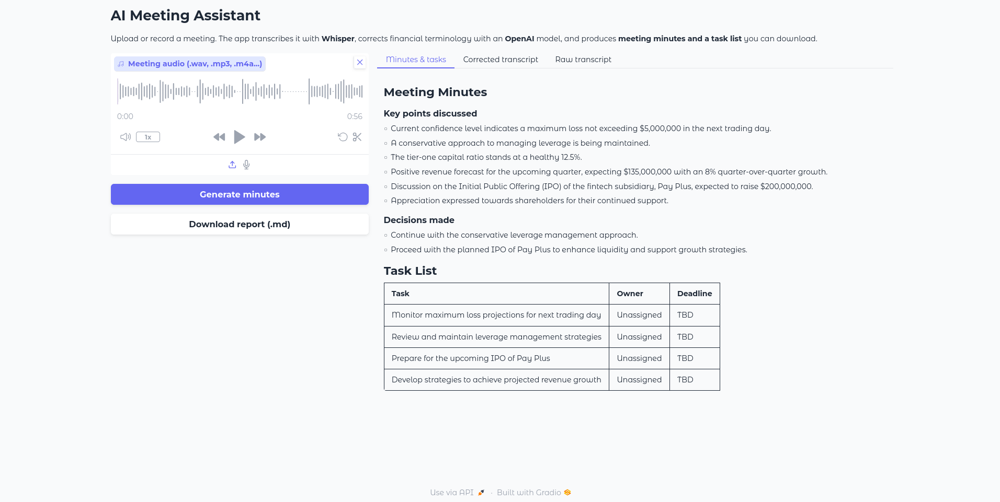
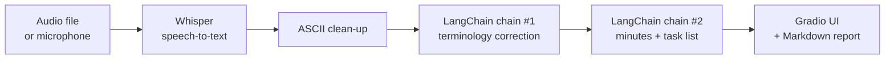

# AI Meeting Assistant

[](https://github.com/ek-neize/ai-meeting-assistant/actions/workflows/tests.yml)


[](https://huggingface.co/spaces/ek-neize/ai-meeting-assistant)

Turn a meeting recording into **clean minutes and an action-item list** in about a minute.
The app transcribes audio locally with OpenAI **Whisper**, uses an **OpenAI GPT model** through
**LangChain** to correct domain terminology, and generates structured Markdown minutes you can download.



## Features

- **Speech-to-text on your machine** with Hugging Face Whisper (GPU used automatically when available). Audio never leaves your computer; only the transcript is sent to the LLM.
- **Domain-aware correction**: expands financial acronyms (`401k` → *401(k) retirement savings plan*, `ROA` → *Return on Assets (ROA)*) and resolves ambiguous terms like `LTV` from context.
- **Structured output**: key points, decisions, and a task table (Task / Owner / Deadline) that marks owners and dates as *Unassigned* / *TBD* instead of inventing them.
- **Upload or record** directly in the browser; supports `.wav`, `.mp3`, `.m4a` and other formats via ffmpeg.
- **Downloadable report** in Markdown with the minutes plus corrected and raw transcripts.
- **Tested pipeline**: unit tests run in CI with fake LLMs, so no API key or model download is needed.

## How it works



Each LLM step is a LangChain Expression Language chain: `{input} | ChatPromptTemplate | ChatOpenAI | StrOutputParser`.
The correction step runs at low temperature (0.2) for consistency; the minutes step runs at 0.5 for more natural summaries.

## Tech stack

| Layer | Tools |
|---|---|
| Speech-to-text | Whisper (`openai/whisper-medium`) via Hugging Face Transformers, PyTorch, ffmpeg |
| LLM orchestration | LangChain (prompt templates, LCEL chains), OpenAI API |
| Interface | Gradio Blocks |
| Quality | pytest, GitHub Actions |

## Quickstart

**Prerequisites:** Python 3.11, [ffmpeg](https://ffmpeg.org/download.html), and an [OpenAI API key](https://platform.openai.com/api-keys).

```bash
git clone https://github.com/ek-neize/ai-meeting-assistant.git
cd ai-meeting-assistant

python3.11 -m venv my_env
source my_env/bin/activate          # Windows: my_env\Scripts\activate
pip install -r requirements.txt

cp .env.example .env                # then paste your OpenAI key into .env
python app.py
```

Open **http://localhost:7860**, upload a recording and click **Generate minutes**.
The first run downloads the Whisper model (about 3 GB); later runs start quickly.

## Configuration

Set these in `.env`:

| Variable | Default | Purpose |
|---|---|---|
| `OPENAI_API_KEY` | — | Required. Your OpenAI API key |
| `OPENAI_MODEL` | `gpt-4o-mini` | Chat model used for both LLM steps |
| `WHISPER_MODEL` | `openai/whisper-medium` | Use `openai/whisper-small` for faster CPU runs |
| `PORT` | `7860` | Web server port |

## Running the tests

```bash
pip install -r requirements-dev.txt
pytest
```

The tests replace the LLMs with fakes and check prompt construction, chain wiring
(including a regression test for a nested-input bug in the original course template),
step ordering and report formatting.

## Project structure

```
ai-meeting-assistant/
├── app.py                  # Gradio UI and request handling
├── meeting_assistant.py    # Core pipeline: prompts, chains, transcription
├── tests/                  # Unit tests (no API key needed)
├── learning/               # Step-by-step scripts from building the project
├── docs/screenshot.png
├── requirements.txt
├── requirements-dev.txt
└── .env.example
```

## Limitations and next steps

- Whisper-medium on CPU takes roughly real-time to transcribe; a GPU or a smaller model is much faster.
- No speaker diarization yet, so tasks are only assigned when names are spoken.
- Ideas: speaker labels with pyannote, configurable domain glossaries beyond finance, export to calendar or project-management tools, and a hosted demo on Hugging Face Spaces.

## Acknowledgements

Built as an extension of the IBM Skills Network *AI Meeting Assistant* guided project, re-implemented
with OpenAI models and extended with a redesigned UI, structured output, tests and CI.

## License

[MIT](LICENSE) © 2026 Ekow Ashun
